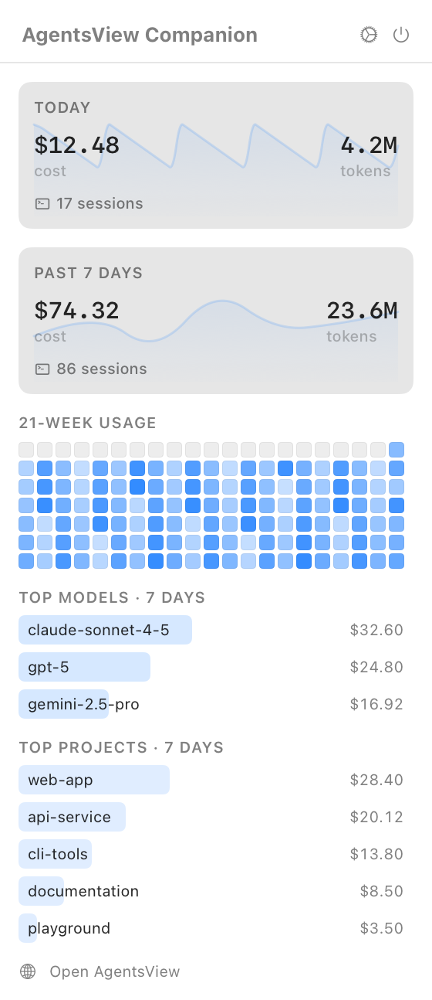

# AgentsView Companion

macOS menu-bar app and Pi `/usage` extension for [AgentsView](https://agentsview.io/).
Shows token usage, costs, charts, and top models/projects using its local API—no
separate collection or pricing backend. Settings can exclude cached tokens from
the display without changing costs.



## Install

Requires macOS 14+ and Xcode Command Line Tools for the app; Pi with Node.js 24+
for the extension. Install and manage AgentsView separately:

```sh
brew install kenn-io/tap/agentsview
agentsview daemon start
git clone https://github.com/bohjak/agentsview-companion
cd agentsview-companion
make install
```

Installs `/Applications/AgentsView Companion.app` and the extension if Pi is
present. Reload Pi afterward. Use `make install-tray` or `make install-pi` to
install just one client; `make uninstall` removes them without deleting data.

Both clients discover the local daemon automatically. Override with the app's
server URL setting or `AGENTSVIEW_URL` for Pi; only unauthenticated loopback
servers are supported. `AGENTSVIEW_DATA_DIR` overrides the discovery directory.

## Pi usage

```text
/usage
/usage --json --tab=models --since=7d
```

Tabs: `summary`, `models`, `repos`, `daily`. Periods: `today`, `7d`, `month`
(30 calendar days), `all` (default). Use ←/→ to switch tabs, `s` to change the
period, and `q` to close. JSON costs are integer microdollars.

## Development

```sh
pnpm install --frozen-lockfile
make build   # macOS app bundle
make check   # typecheck, tests, shell checks, macOS build
```

Requires Node.js 24+, pnpm, and full Xcode for Swift tests.

Personal project, provided without support or compatibility guarantees.
[MIT License](LICENSE).
